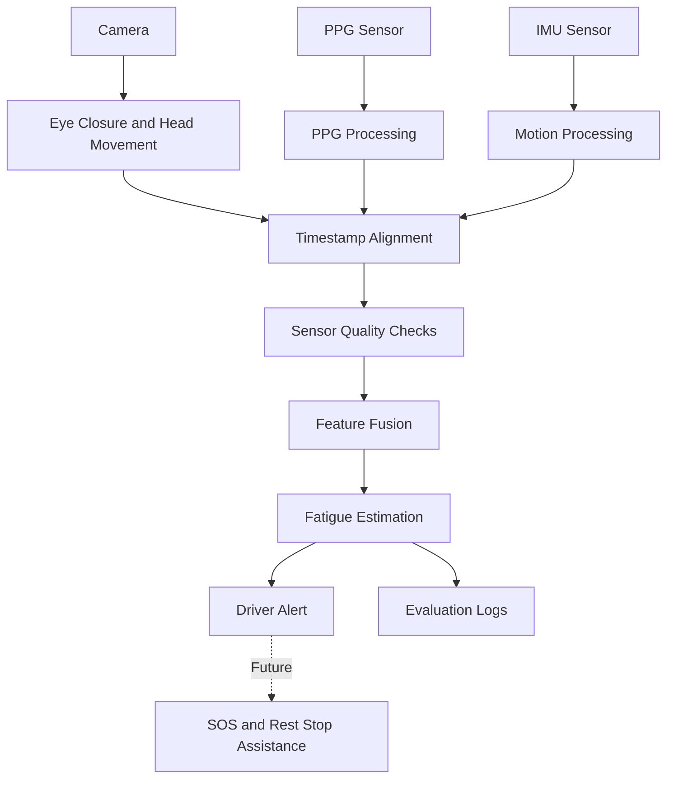

# DriveSense — Technical Design Document

## 1. Introduction
DriveSense aims to detect possible driver fatigue using camera-derived features, photoplethysmography (PPG), and inertial measurement unit (IMU) signals. The system will combine these inputs to estimate fatigue and provide timely warnings.

## 2. System Architecture

## 3. Main Modules
1. Camera module: captures frames and extracts eye-closure and head-movement features.
2. PPG module: processes physiological signals and checks signal quality.
3. IMU module: processes motion measurements.
4. Synchronization module: aligns data using timestamps.
5. Sensor-fusion module: combines valid features.
6. Fatigue-estimation module: produces a risk score or classification.
7. Alert module: displays warnings based on configured decision criteria.
8. Logging module: records limited information required for evaluation.

## 4. Processing Workflow
1. Acquire available sensor inputs.
2. Extract relevant features.
3. validate signal quality and timestamps.
4. Align the inputs into time windows.
5. Fuse the available features.
6. Estimate possible fatigue.
7. Display a warning when the validated decision rule is satisfied.
8. Record evaluation results.

## 5. Failure Handling
- Camera unavailable: report the camera error.
- Missing PPG or IMU data: mark the input unavailable.
- Poor signal quality: avoid making a confident prediction.
- Invalid timestamps: reject or correct the affected window.
- Configuration failure: report the problem and avoid unsafe operation.

## 6. Evaluation
Evaluate sensitivity, specificity, false-alert rate, missed-event rate, and response latency using appropriately labelled test data. Document dataset size, testing conditions, and limitations. Do not claim accuracy before testing.

## 7. Future Enhancements
Future work may include SOS notifications, navigation to nearby rest stops or emergency facilities, and autonomous safe stopping. These capabilities require separate implementation, consent, reliability testing, and safety validation.

## 8. Privacy
Use informed consent, restrict access to sensor recordings, minimize data retention, and never commit credentials or personal information to the repository.

## 9. Project Status
This document describes a proposed architecture. Update it as modules are implemented and tested.
